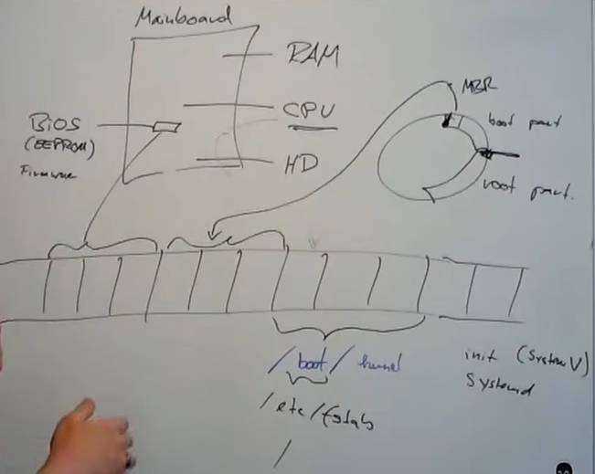

# 1. Overview
## Hardware overview
- Boot process:
    + khi khởi động, firmware trong bios (eeprom) sẽ được nạp vào địa chỉ trong RAM
    + CPU sẽ đọc địa chỉ RAM đó thông qua instruction pointer
    + sau đó firmware tìm tới sector chứa boot của ổ cứng và load địa chỉ sector đó vào ram, CPU sẽ chuyển pointer qua vùng này để đọc
    + trong boot sector của ổ cứng sẽ chứa bootloader, firmware sẽ copy bootloader đó vào ram, CPU chuyển tới vùng này để nạp bootloader
    + 
    + `/etc/fstab`: cấu hình việc mount tự động các phân vùng ổ cứng vào hệ thống khi hệ thống khởi động, nó chạy khi kernel đã khởi động xong và trong quá trình thiết lập của systemv/systemd
- part 1 18:26